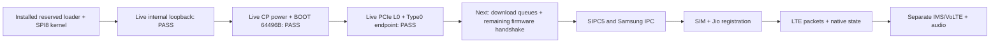
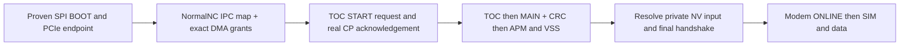

# Cellular approach: Pixel versus our Galaxy S20

Status: 2026-11-12 15:08. Live BOOT64496B, PCIe L0 and distinct Type0 modem
endpoint are proven; verified shutdown leaves CP off and iOS running. Reserved
loader/SPI8 kernel installed. LTE/calls remain unavailable. Next: download
queues/remaining firmware, IPC and precise memory/cache/DMA backend. SIM is
currently OUT; target later is Jio India LTE/VoLTE ([requirements](jio.md)).

## Architecture

| Layer | Pixel reference | S20 SM-G980F |
| --- | --- | --- |
| Modem | Qualcomm | Samsung Shannon S5123 |
| Boot/link | Qualcomm firmware, GLINK/QRTR | GPIO power/reset, SPI16 BOOT, PCIe1 |
| SIM/network control | QMI UIM/NAS/WDS | Samsung IPC over SIPC5 |
| Packet transport | IPA/GSI/QMAP | CPIF shared queues and pktproc |
| iOS network | Virtual interface, routes, DNS | Same architecture after Samsung transport works |
| Native status/UI | CoreTelephony hooks + status bridge | Feed real Samsung state into native UI |
| Calls | No verified voice/IMS found in audited branches | Separate IMS/call control, modem audio and native Phone integration |

```mermaid
flowchart TD
    subgraph Pixel
        P1[Qualcomm modem] --> P2[GLINK / QRTR + QMI]
        P2 --> P3[SIM registration + data session]
        P3 --> P4[IPA / GSI / QMAP packets]
        P4 --> P5[iOS virtual interface + routes + DNS]
        P5 --> P6[LTE internet]
    end
    subgraph S20
        S0[CP memory reservation + live cache checks] --> S1[GPIO power/reset + SPI16 BOOT]
        S1 --> S2[PCIe1 + remaining modem firmware]
        S2 --> S3[SIPC5 + Samsung IPC]
        S3 --> S4[SIM registration + data session]
        S4 --> S5[CPIF / pktproc packets]
        S5 --> S6[iOS virtual interface + routes + DNS]
        S6 --> S7[LTE internet]
        S3 --> V1[Separate call / IMS control]
        V1 --> V2[Modem voice + ABOX audio]
        V2 --> V3[Native Phone integration]
    end
```

The requested Pixel `ws-n-celldata` branch mainly supplies UI/telephony hooks;
working packet code is on its companion `ws-n-ipa-gsi1` branch. Its author
records LTE browsing and SMS sending in the pinned
[test notes](https://github.com/DenialOfGravity/ios-redfin/blob/feb2e67b880150617b939e154169bda8e84a4e34/NOTES.md).
We can reuse the integration architecture, validation discipline and some UI
ideas. Qualcomm QMI/IPA drivers cannot operate Samsung SPI/PCIe/SIPC hardware.

## Work and proof required

| Stage | State | What counts as success |
| --- | --- | --- |
| Upstream audit + isolated branch | Done | Pinned comparison, no blind merge into other agents' tree |
| Cellular Settings page | Installed, user-confirmed | Native page; service/calls honestly unavailable |
| CP memory ownership/cache | Installed: loader reservations3/3, prekernel NormalNC3/3 | XNU shared-RAM cache mapping still needs implementation/proof before DMA |
| GPIO/clock/pin baseline | Read-only snapshots done | Documented actual state; no unclocked SPI/PCIe access |
| SPI16 transport | Host model and phone internal loopback pass | Next: bounded CP power/reset, real BOOT transfer and CP acceptance proof |
| CP power + firmware boot | Live SPI BOOT + PCIe Type0 endpoint and shutdown proven; MAIN pending | Bounded sequence, cleanup, CP-side handshake, not just bytes transmitted |
| PCIe1 transport | Live L0 and distinct Type0 modem endpoint proven; DMA/download pending | Link/enumeration, DMA isolation, remaining firmware, completion handshake |
| SIPC5 + Samsung IPC | Ring core and external UDL codec host-tested; live IPC pending | Queues/doorbells/interrupts, flow control and crash recovery |
| SIM + network registration | Pending | Actual SIM/operator/signal and bounded rejection/reconnect handling |
| LTE packet session | Pending | Address/gateway/DNS/MTU and bidirectional CPIF/pktproc traffic |
| iOS internet | Pending | Interface/routes/DNS; HTTPS proven with Wi-Fi excluded |
| UI from modem state | Pending | Actual signal/service/session state; switch controls real traffic |
| Calls/IMS/audio | Pending | Incoming/outgoing state, two-way audio, proximity/routes, native Phone |

## Bring-up method

Use the original working UEFI wherever possible. Its boot services now support
the tested CP reservations, so the failed full native-FD replacement is not a
prerequisite. Keep modem execution disabled until each lower layer is proven.

Each hardware step uses the shared phone lock, isolated artifacts, bounded
timeouts and exact original BOOT/recovery backups. Preflights load the exact
original loader before probing and hand off to it afterward. The host collects
a bounded RAM report and restores original BOOT. Do not start concurrent writers.
Other agents' kernel source/build trees remain untouched.

Detailed pins, source revisions, commands, evidence and acceptance checklist:
[cellular-s20.md](s20.md).

## Live-first workflow (user direction, Nov12)

- No queued auto-reboot. Previous charge dispatcher exited before flashing on
  phone lock handoff; do not restart it automatically.
- Existing generic debug sysctl is sufficient for bounded status and CP-off
  root-port controls. New signed live helper records each phase, uses masked
  writes, restores clock/isolation/PERST, and reports unverified cleanup.
- Live status is the first device check; the mutating root probe waits for the
  normal phone lock. Cellular currently owns it by explicit user handoff.
- A timeout or disconnect is not proof of hardware failure; preserve transcript
  and check charge/USB/kernel state before recovery or another attempt.
- Live debugging does not make an unsafe register safe. Use source-derived
  clock/power/ownership guards; keep CP off until its memory ownership is proven.
- The combined reserved-memory loader and SPI8 kernel are now installed and
  verified. LIVE loopback and real CP BOOT pass; modem safely off afterward.
  Before DMA, implement/prove appropriate XNU CP shared-RAM mappings.
- Notify the user before every restart. No repeated boot for individual knobs.

The live helper does not provide LTE. Remaining proof after the verified PCIe endpoint: MAIN/APM and modem ONLINE, transport/IPC, SIM/Jio registration, LTE packets, then
IMS/VoLTE and two-way audio.

## Current execution flow — Nov12 14:52

Real live BOOT691328us; wake/PS_HOLD transitions observed, verified shutdown.
CP currently off; no phone restart needed. SIM remains out until registration
can actually be tested. The UI currently reports unavailable service honestly.

Nov12 15:08: live endpoint proof PASS; ROOT Type1/command00100000 versus EP
Type0/IDa5a5144d. EP BME106 cleared102, no DMA enable. Cleanup1, CP off, iOS
running. No restart for these iterations. Next: [download backend plan](download-plan.md).

## Next firmware path (source recovered, not yet live)

Samsung's external SIPC loader source now gives the command and acknowledgement
format. Encoder and ordered RADIO plan pass host tests; no UDL command has been
sent yet. See the [pinned source and checklist](download-plan.md).
